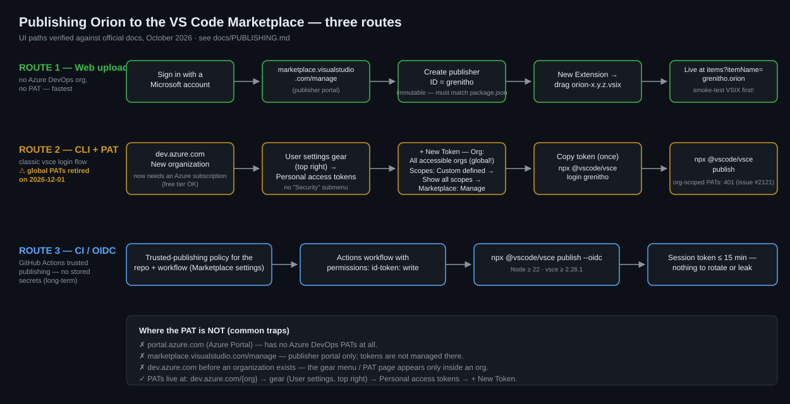

# Publishing Orion to the VS Code Marketplace

Owner runbook (UI paths verified against the official docs in October 2026).
Everything mechanical is checked by CI-grade commands below; everything that
needs a human account is flagged MANUAL.

## Three routes — pick one

| Route | Prerequisites | Status / best for |
|---|---|---|
| **1. Web upload** | Microsoft account only | **Recommended now.** No Azure DevOps org, no PAT. Manual per release. |
| **2. CLI with PAT** | Azure DevOps org + *global* PAT (`Marketplace > Manage`) | Works today, but **global PATs are retired on 2026-12-01** — plan to move off it. |
| **3. CI via GitHub Actions OIDC** | GitHub repo + Marketplace trusted-publishing policy + workflow | Long-term automated releases; no stored secrets (`vsce publish --oidc`). |



Key facts that trip people up (all verified Oct 2026):

- Personal access tokens live on **dev.azure.com only** — not in the Azure
  portal (portal.azure.com), not on marketplace.visualstudio.com/manage, and
  there is **no "Security" submenu** in the current user-settings dropdown.
- The PAT page only appears **after an Azure DevOps organization exists**, and
  creating a *new* org now requires selecting an **Azure subscription** for
  billing (the free tier is fine; the wizard links to creating a free Azure
  subscription, identity verification may ask for a card, $0 charged).
- The Marketplace publishing API still requires a **global** PAT
  ("All accessible organizations"). Org-scoped PATs are **not** accepted yet —
  see the open request [microsoft/vsmarketplace#2121](https://github.com/microsoft/vsmarketplace/issues/2121).
- **Global PATs are decommissioned on December 1, 2026** (creation is still
  allowed until then). After that date, use Route 1, Route 3, or
  `vsce publish --azure-credential` (Microsoft Entra ID).

## Route 1 — Web upload (MANUAL, no Azure org, no PAT)

1. Build the exact VSIX you intend to ship (no login needed for packaging):
   ```bash
   cd orion
   npm run package          # webpack/tsc build
   npx @vscode/vsce package # -> orion-<version>.vsix (Node >= 22 for current vsce)
   ```
2. Smoke-test that VSIX locally first (`code --install-extension orion-<version>.vsix --force`,
   one full chat round-trip). Marketplace versions are **immutable** — a bad
   upload can only be hidden or superseded, never overwritten.
3. Go to https://marketplace.visualstudio.com/manage and sign in with a
   Microsoft account (personal outlook/hotmail/live accounts work).
4. **Create publisher** (left pane, first time only):
   - **ID**: `grenitho` — must match the `publisher` field in
     `orion/package.json`; **the ID cannot be changed once created**.
   - **Name**: display name shown on the Marketplace (e.g. `Orie Grenitho`).
5. Open the publisher → **New Extension** → **Visual Studio Code** → drag the
   `.vsix` in → wait for validation → details are pre-filled from
   `package.json` → publish.
6. Propagation takes a few minutes. Verify:
   `https://marketplace.visualstudio.com/items?itemName=grenitho.orion`
   and install from the Marketplace in a clean VS Code profile.

Later releases: bump version + CHANGELOG, `vsce package`, upload the new VSIX
the same way.

## Route 2 — CLI with a PAT (MANUAL one-time setup; works until 2026-12-01)

### 2a. Azure DevOps organization (only if you don't have one)

Sign in at https://dev.azure.com → **New organization** → name (letters/
digits/hyphens), hosting geography, and an **Azure subscription** for billing
(free tier = $0; the wizard offers creating a free Azure subscription if you
have none) → **Continue** → create a project when prompted. The org name is
irrelevant to the Marketplace; only the publisher ID matters.

### 2b. Create the PAT — exact click path (current UI)

1. Open the org home: `https://dev.azure.com/{organization}`.
2. Top-right header: click the **User settings** gear (next to your profile
   image) → **Personal access tokens**.
3. **+ New Token**.
4. In the create dialog:
   - **Name**: e.g. `orion-vsce`.
   - **Organization**: **All accessible organizations** (a *global* PAT —
     required by the Marketplace API; org-scoped PATs fail there).
   - **Expiration (UTC)**: shortest practical window (org policy caps the max;
     the token must simply be valid on publish days).
   - **Scopes**: **Custom defined** → click **Show all scopes** (bottom of the
     scope list) → scroll to **Marketplace** → select **Manage**.
5. **Create** → **copy the token immediately** — it is shown exactly once.
   Never commit it; never put it in `.env`. `vsce login` stores it in the
   Windows Credential Manager.

### 2c. Login & publish

```bash
cd orion
npx @vscode/vsce login grenitho    # paste the PAT when prompted
npx @vscode/vsce publish           # or: publish minor|patch|major to bump + upload in one step
```

Troubleshooting:

| Symptom | Cause / fix |
|---|---|
| No "Personal access tokens" entry anywhere | You are on portal.azure.com or marketplace.visualstudio.com — PATs exist only under dev.azure.com, and only once an org exists. |
| dev.azure.com shows "Create new organization" onboarding | No org yet → do 2a first (needs an Azure subscription selection). |
| "Marketplace" scope not visible | Click **Show all scopes** under the Scopes list. |
| `401 Unauthorized` from vsce | PAT was org-scoped or expired → recreate as global with `Marketplace > Manage`. |
| Publisher not found on login | Publisher ID must be created first at the manage site (Route 1 step 4) and match `package.json`. |

After 2026-12-01 global PATs stop working: fall back to Route 1, or migrate to
`vsce publish --azure-credential` (Entra ID) / Route 3.

## Route 3 — Trusted publishing via GitHub Actions (no stored secrets)

`vsce publish --oidc` exchanges a GitHub Actions OIDC token for a short-lived
Marketplace session token: configure a trusted-publishing policy for the repo
and workflow in the Marketplace publisher settings, then run a workflow with
`permissions: id-token: write` (full sample in the
[vsce README](https://github.com/microsoft/vscode-vsce)). Adopt this when
release cadence justifies CI; until then Route 1 is enough.

## Pre-publish checklist (per release, all routes)

- [ ] `main` is the release commit; `python -m pytest backend/app/services/ -q` green; `npm run compile` clean
- [ ] version bumped in `orion/package.json` and `orion/CHANGELOG.md` has the entry
- [ ] VSIX built from this exact tree; installed locally; one chat round-trip smoke-tested
- [ ] `npx @vscode/vsce ls` shows no secrets (`.vscodeignore` keeps `.env`, `.orion/`,
      `src/`, `node_modules/`, `tools/` out — re-verify when adding files)
- [ ] icon present: `resources/orion-icon.png` (256 px, dark background); the
      `icon` field in `package.json` must point to a **PNG** — vsce refuses SVG icons

## GitHub Release (mirror for non-Marketplace users)

```bash
git tag v<version> && git push origin v<version>
```
Then GitHub → Releases → *Draft a release from tag* → attach
`orion-<version>.vsix` → paste the CHANGELOG entry as release notes.

## Rollback / republish

Marketplace versions are immutable: a bad upload cannot be overwritten, only
hidden (unpublish) or superseded by a newer version. That is why the checklist
installs and smoke-tests the exact VSIX before publishing.

## Icon regeneration

`resources/orion-icon.png` is a faithful raster of `resources/orion-icon.svg`
(white delta ring on the gallery-banner colour), rendered with 4x
supersampling by `orion/tools/make-icon.py` (pure stdlib):

```bash
python3 tools/make-icon.py 256 resources/orion-icon.png
```

Keep ≥128 px and keep the dark background so the mark reads on light
Marketplace pages.
